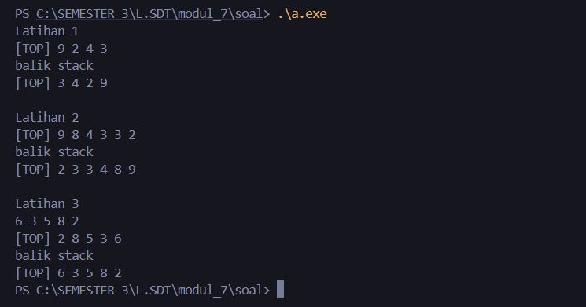
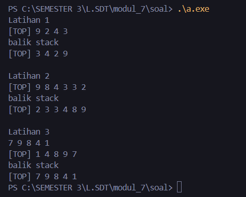

# <h1 align="center">Laporan Praktikum Modul 7 - STACK (Bagian Pertama)</h1> 

<p align="center">Leonardo Farriz Garcya - 109082530036</p>

# Dasar Teori
### A. Konsep dan Operasi Dasar Stack<br/>
 
Stack merupakan salah satu bentuk struktur data turunan dari linked list yang prinsip aksesnya dibatasi hanya pada satu ujung saja.
 
#### 1. Pengertian dan Prinsip LIFO pada Stack
 
Stack merupakan salah satu bentuk struktur data yang prinsip operasinya menyerupai tumpukan, di mana elemen yang bisa diambil lebih dulu adalah elemen yang berada paling atas, atau elemen yang terakhir kali dimasukkan. Prinsip ini biasa disebut LIFO (*Last In First Out*), berbeda dengan singly linked list yang elemennya dapat diakses dari posisi mana pun sepanjang list [1].
 
#### 2. Komponen Stack dan Representasinya dengan Pointer
 
Komponen-komponen dalam stack pada dasarnya sama dengan komponen pada singly linked list, hanya saja akses pada stack hanya bisa dilakukan pada satu ujung saja, yaitu elemen paling atas yang disebut *Top*. Secara struktur, elemen stack direpresentasikan dengan struct yang berisi *info* dan pointer *next*, sedangkan struct stack sendiri hanya memiliki satu field pointer, yaitu *Top*, yang menunjuk ke elemen paling atas [1].
 
#### 3. Operasi Push dan Pop
 
Dalam stack terdapat dua operasi utama, yaitu *push* untuk menyisipkan elemen ke tumpukan dan *pop* untuk mengambil elemen dari tumpukan. Operasi *push* pada dasarnya sama dengan operasi *insert first* pada singly linked list, karena elemen baru selalu diletakkan sebagai elemen paling atas yang baru. Sebaliknya, operasi *pop* mirip dengan operasi *delete first*, karena elemen yang diambil selalu elemen yang berada di posisi *Top*, sebelum *Top* dipindahkan ke elemen di bawahnya [2].
 
### B. Implementasi Stack dalam Bahasa C++<br/>
 
Selain dengan pointer, stack juga dapat direpresentasikan dengan tabel, dan keduanya tetap mengikuti prinsip primitif yang serupa.
 
#### 1. Primitif-primitif dalam Stack
 
Primitif-primitif dalam stack pada dasarnya sama dengan primitif pada model list lainnya, meliputi `createStack()` untuk membuat stack kosong, `isEmpty()` untuk mengecek status stack, `alokasi()` dan `dealokasi()` untuk manajemen memori elemen, serta fungsi-fungsi pencarian dan primitif pendukung lainnya. Hanya saja jumlah primitif dalam stack relatif lebih sedikit dibanding list biasa, karena operasi yang dilakukan hanya terbatas pada elemen paling atas [3].
 
#### 2. Representasi Stack dengan Tabel (Array)
 
Selain dengan pointer, stack juga dapat direpresentasikan menggunakan tabel (*array*). Perbedaan utamanya terletak pada pendeklarasian struktur datanya, yaitu memakai array berindeks dengan jumlah tumpukan yang terbatas sesuai kapasitas maksimum (*Imax*) yang ditentukan sejak awal, berbeda dengan representasi pointer yang bersifat dinamis [1].
 
#### 3. Operasi Push dan Pop pada Representasi Tabel
 
Pada representasi tabel, operasi *push* dilakukan dengan menggeser indeks *Top* ke posisi berikutnya terlebih dahulu (*Top* = *Top* + 1), barulah elemen baru dimasukkan pada indeks tersebut. Sebaliknya, operasi *pop* dilakukan dengan mengambil nilai pada indeks *Top* lebih dulu, baru kemudian indeks *Top* digeser mundur satu posisi (*Top* = *Top* - 1), tanpa benar-benar menghapus nilai pada indeks sebelumnya. Karena tidak memakai pointer, representasi tabel juga tidak membutuhkan manajemen memori seperti alokasi dan dealokasi yang diperlukan pada representasi pointer.


```

## Guided_1

### 1. 

## stack.h
## Unguided

### 1. ...
#ifndef STACK_TABLE
#define STACK_TABLE
#include <iostream>
using namespace std;
const int MAX = 10;

struct stackTable
{
    int data[MAX];
    int top;
};
bool isEmpty(stackTable s);
bool isFull(stackTable s);
void createStack(stackTable &s);
void push(stackTable &s, int angka);
void pop(stackTable &s); 
void update(stackTable &s, int posisi);
void view(stackTable s);
void searchData(stackTable s, int data);
#endif

```

## stack.cpp
```C++
#include "stack.h"
#include <iostream>
using namespace std;

bool isEmpty(stackTable s)
{
    return s.top == -1;
}
bool isFull(stackTable s)
{
    return s.top == MAX - 1;
}
void createStack(stackTable &s)
{
    s.top = -1;
}
void push(stackTable &s, int angka)
{

    if (isFull(s))
    {
        cout << "Stack penuh!" << endl;
    }
    else
    {
        s.top++;
        s.data[s.top] = angka;
        cout << "Data" << angka << "berhasil ditambahkan kedalam stack !" << endl;
    }
}

void pop(stackTable &s)
{
    if (isEmpty(s))
    {
        cout << "Stack kosong!" << endl;
    }
    else
    {
        int val = s.data[s.top];
        s.top--;
        cout << "Data" << val << " berhasil dihapus dari stack!" << endl;
    }
}

void update(stackTable &s, int posisi)
{
    if (isEmpty(s))
    {
        cout << "Stack kosong!" << endl;
    }
    if (posisi <= 0)
    {
        cout << "Posisi tidak valid!" << endl;
        return;
    }
    // index = top

    int idx = s.top - (posisi - 1);
    if (idx < 0 || idx > s.top)
    {
        cout << "Posisi " << posisi << " tidak valid!" << endl;
        return;
    }

    cout << "Update data posisi ke-" << posisi << endl;
    cout << "Masukkan angka : ";
    cin >> s.data[idx];
    cout << "Data berhasil diupdate!" << endl;
    cout << endl;
}

void view(stackTable s)
{
    if (isEmpty(s))
    {
        cout << "Stack kosong!" << endl;
    }
    else
    {
        for (int i = s.top; i >= 0; --i)
        {
            cout << s.data[i] << " ";
        }
    }
    cout << endl;
}

void searchData(stackTable s, int data)
{
    if (isEmpty(s))
    {
        cout << "Stack kosong!" << endl;
        return;
    }

    cout << "Mencari data " << data << "..." << endl;
    int posisi = 1;
    bool found = false;

    for (int i = s.top; i >= 0; --i)
    {
        if (s.data[i] == data)
        {
            cout << "Data " << data << " ditemukan pada posisi ke-" << posisi << endl;
            cout << endl;
            found = true;
            break;
        }
        posisi++;
    }

    if (!found)
    {
        cout << "Data " << data << " tidak ditemukan didalam stack!" << endl;
        cout << endl;
    }
}

```
## main.cpp
```C++
#include "stack.h"
#include <iostream>

using namespace std;

int main()
{
    stackTable s;
    createStack(s);

    push(s, 1);
    push(s, 2);
    push(s, 3);
    push(s, 4);
    push(s, 5);
    cout << endl;

    cout << "--- Stack setelah push ---" << endl;
    view(s);
    cout << endl;

    pop(s);
    pop(s);
    cout << endl;

    cout << "--- Stack setelah pop 2 kali ---" << endl;
    view(s);
    cout << endl;

    update(s, 2);
    update(s, 1);
    cout << endl;

    cout << "--- Stack setelah update ---" << endl;
    view(s);
    cout << endl;

    searchData(s, 4);
    searchData(s, 9);

    return 0;
}
```

<p> Di `stack.h`, konstanta `MAX` bernilai 10 sebagai kapasitas stack, dan `struct stackTable` berisi array `data[MAX]` untuk menyimpan angka serta variabel `top` yang menunjukkan indeks data paling atas. Header ini juga memuat deklarasi delapan fungsi: `isEmpty()`, `isFull()`, `createStack()`, `push()`, `pop()`, `update()`, `view()`, dan `searchData()`. Baris `#ifndef`, `#define`, dan `#endif` mencegah header terbaca dua kali, dan `using namespace std;` membuat `cout`, `cin`, dan `endl` bisa ditulis tanpa `std::`.</p>
 
<p>Di `stack.cpp`, `createStack()` membuat stack kosong dengan mengisi `top` dengan -1. `isEmpty()` mengecek apakah `top` bernilai -1, sedangkan `isFull()` mengecek apakah `top` sudah mencapai `MAX - 1`. `push()` menambah data: kalau stack tidak penuh, `top` dinaikkan satu lalu angka disimpan di `data[top]`, dan kalau penuh akan muncul pesan "Stack penuh!". `pop()` menghapus data teratas dengan menurunkan `top` satu, dan kalau stack kosong akan muncul pesan "Stack kosong!". Data yang di-pop sebenarnya masih ada di array, tapi sudah tidak dihitung karena berada di atas `top`.</p>
 
<p>`update()` mengubah data pada posisi tertentu, dengan posisi dihitung dari atas (posisi 1 adalah data paling atas). Indeks array-nya dihitung dengan `idx = top - (posisi - 1)`, lalu fungsi mengecek apakah posisi valid, dan kalau valid pengguna diminta mengetik angka baru yang disimpan ke `data[idx]`. `view()` menampilkan isi stack dari `top` turun sampai indeks 0, jadi data paling atas tercetak paling pertama. `searchData()` menelusuri stack dengan cara yang sama sambil menghitung posisi (mulai dari 1), lalu menampilkan posisi data yang dicari atau pesan "tidak ditemukan". Parameter `stackTable &s` memakai `&` pada fungsi yang mengubah stack supaya yang berubah adalah stack aslinya, sedangkan `view()`, `searchData()`, `isEmpty()`, dan `isFull()` yang hanya membaca cukup memakai `stackTable s`.</p>
 
<p> Di `main()`, stack dibuat dengan `createStack()`, lalu angka 1 sampai 5 di-push berurutan dan isinya ditampilkan: `5 4 3 2 1`, karena angka terakhir yang masuk ada di paling atas. Dua kali `pop()` menghapus 5 dan 4, sehingga isinya menjadi `3 2 1`. Lalu `update(s, 2)` mengubah data di posisi ke-2 dari atas (angka 2) dan `update(s, 1)` mengubah data paling atas (angka 3) dengan angka yang diketik pengguna. Terakhir `searchData()` dipanggil untuk mencari angka 4 dan 9 di dalam stack. Hasil pencarian bergantung pada angka yang diketik saat update: pada contoh di bawah, angka yang diketik adalah 9 dan 4, sehingga keduanya ditemukan.</p>
## Unguided

### Guided_2

### 2.

## stack.h
```C++
#ifndef STACK
#define STACK
#define Nil NULL

#include <iostream>
using namespace std;
const int MAX = 10;

typedef struct node *address;

struct node
{
    int dataAngka;
    address next;
};

struct stack
{
    address top;
};

bool isEmpty(stack listStack);
void createStack(stack &listStack);
address alokasi(int angka);
void dealokasi(address &node);

void push(stack &listStack, address nodeBaru);
void pop(stack &listStack); 
void update(stack &listStack, int posisi);
void view(stack &listStack);
void searchData(stack listStack, int data);
#endif

```
## stack.cpp
```C++
#include "stack.h"

void createStack(Stack &S) {
    S.top = -1;
}

void push(Stack &S, infotype x) {
    if (S.top == 19) {
        cout << "Stack penuh!" << endl;
    } else {
        S.top++;
        S.info[S.top] = x;
    }
}

infotype pop(Stack &S) {
    infotype x = -1;
    if (S.top == -1) {
        cout << "Stack kosong!" << endl;
    } else {
        x = S.info[S.top];
        S.top--;
    }
    return x;
}

void printInfo(Stack S) {
    cout << "[TOP] ";
    for (int i = S.top; i >= 0; i--) {
        cout << S.info[i] << " ";
    }
    cout << endl;
}

void balikStack(Stack &S) {
    int i = 0;
    int j = S.top;
    while (i < j) {
        infotype temp = S.info[i];
        S.info[i] = S.info[j];
        S.info[j] = temp;
        i++;
        j--;
    }
}

void pushAscending(Stack &S, infotype x) {
    if (S.top == 19) {
        cout << "Stack penuh!" << endl;
    } else {
        int i = S.top;
        while (i >= 0 && S.info[i] > x) {
            S.info[i + 1] = S.info[i];
            i--;
        }
        S.info[i + 1] = x;
        S.top++;
    }
}

void getInputStream(Stack &S) {
    char c = cin.get();
    while (c != '\n') {
        if (c >= '0' && c <= '9') {
            push(S, c - '0');
        }
        c = cin.get();
    }
}

```
## main.cpp
```C++
#include <iostream>
#include "stack.h"
using namespace std;

int main()
{
    Stack S;

    cout << "Latihan 1" << endl;
    createStack(S);
    push(S, 3);
    push(S, 4);
    push(S, 8);
    pop(S);
    push(S, 2);
    push(S, 3);
    pop(S);
    push(S, 9);
    printInfo(S);
    cout << "balik stack" << endl;
    balikStack(S);
    printInfo(S);
    cout << endl;

    cout << "Latihan 2" << endl;
    createStack(S);
    pushAscending(S, 3);
    pushAscending(S, 4);
    pushAscending(S, 8);
    pushAscending(S, 2);
    pushAscending(S, 3);
    pushAscending(S, 9);
    printInfo(S);
    cout << "balik stack" << endl;
    balikStack(S);
    printInfo(S);
    cout << endl;

    cout << "Latihan 3" << endl;
    createStack(S);
    getInputStream(S);
    printInfo(S);
    cout << "balik stack" << endl;
    balikStack(S);
    printInfo(S);

    return 0;
}
```

<p>Di `stack.cpp`, `createStack()` membuat stack kosong dengan mengisi `top` dengan -1. `push()` menambah data: kalau `top` sudah 19 (array penuh) akan muncul pesan "Stack penuh!", dan kalau belum, `top` dinaikkan satu lalu angka disimpan di `info[top]`. `pop()` mengambil data teratas dengan menurunkan `top` satu dan mengembalikan nilainya, atau menampilkan "Stack kosong!" dan mengembalikan -1 kalau stack kosong. `printInfo()` mencetak isi stack dari `top` turun sampai indeks 0 dengan awalan `[TOP]`, jadi data paling atas tercetak paling pertama.</p>
 
<p>`balikStack()` membalik urutan isi stack dengan dua penanda, `i` dari indeks 0 dan `j` dari `top`. Selama `i < j`, isi `info[i]` dan `info[j]` ditukar memakai variabel `temp`, lalu `i` dinaikkan dan `j` diturunkan, sampai keduanya bertemu di tengah. `pushAscending()` memasukkan angka ke stack sambil menjaga urutannya tetap menaik dari bawah ke atas. Angka-angka di atas yang lebih besar dari `x` digeser satu tempat ke atas (`info[i + 1] = info[i]`), lalu `x` ditaruh di celah yang terbentuk dan `top` dinaikkan. Dengan begini, data terbesar selalu berada di paling atas. `getInputStream()` membaca ketikan pengguna karakter demi karakter dengan `cin.get()` sampai menemukan Enter (`'\n'`). Karakter yang berupa angka (`'0'` sampai `'9'`) diubah menjadi bilangan dengan `c - '0'` lalu di-push, sedangkan karakter lain diabaikan.</p>
 
<p>Di `main()`, ada tiga latihan yang masing-masing diawali `createStack()`. Latihan 1 menjalankan rangkaian push dan pop: push 3, 4, 8, pop (8 keluar), push 2, 3, pop (3 keluar), lalu push 9, sehingga isinya `9 2 4 3` dari atas, dan setelah dibalik menjadi `3 4 2 9`. Latihan 2 memasukkan 3, 4, 8, 2, 3, 9 dengan `pushAscending()`, sehingga isinya terurut dengan 9 di paling atas (`9 8 4 3 3 2`), dan setelah dibalik terurut dengan 2 di paling atas (`2 3 3 4 8 9`). Latihan 3 membaca angka yang diketik pengguna lewat `getInputStream()`: pada contoh di bawah, pengguna mengetik `4729`, sehingga angka 4, 7, 2, 9 di-push berurutan dan 9 berada di paling atas. </p>

## Unguided

### 1. soal
## stack.h
```C++
#ifndef STACK_H_INCLUDED
#define STACK_H_INCLUDED

#include <iostream>
using namespace std;

typedef int infotype;

struct Stack {
    infotype info[20];
    int top;
};

void createStack(Stack &S);
void push(Stack &S, infotype x);
infotype pop(Stack &S);
void printInfo(Stack S);
void balikStack(Stack &S);
void pushAscending(Stack &S, infotype x);
void getInputStream(Stack &S);

#endif

```

## stack.cpp
```C++
#include "stack.h"

void createStack(Stack &S) {
    S.top = -1;
}

void push(Stack &S, infotype x) {
    if (S.top == 19) {
        cout << "Stack penuh!" << endl;
    } else {
        S.top++;
        S.info[S.top] = x;
    }
}

infotype pop(Stack &S) {
    infotype x = -1;
    if (S.top == -1) {
        cout << "Stack kosong!" << endl;
    } else {
        x = S.info[S.top];
        S.top--;
    }
    return x;
}

void printInfo(Stack S) {
    cout << "[TOP] ";
    for (int i = S.top; i >= 0; i--) {
        cout << S.info[i] << " ";
    }
    cout << endl;
}

void balikStack(Stack &S) {
    int i = 0;
    int j = S.top;
    while (i < j) {
        infotype temp = S.info[i];
        S.info[i] = S.info[j];
        S.info[j] = temp;
        i++;
        j--;
    }
}

void pushAscending(Stack &S, infotype x) {
    if (S.top == 19) {
        cout << "Stack penuh!" << endl;
    } else {
        int i = S.top;
        while (i >= 0 && S.info[i] > x) {
            S.info[i + 1] = S.info[i];
            i--;
        }
        S.info[i + 1] = x;
        S.top++;
    }
}

void getInputStream(Stack &S) {
    char c = cin.get();
    while (c != '\n') {
        if (c >= '0' && c <= '9') {
            push(S, c - '0');
        }
        c = cin.get();
    }
}
```

## main.cpp
```C++
#include <iostream>
#include "stack.h"
using namespace std;

int main()
{
    Stack S;

    cout << "Latihan 1" << endl;
    createStack(S);
    push(S, 3);
    push(S, 4);
    push(S, 8);
    pop(S);
    push(S, 2);
    push(S, 3);
    pop(S);
    push(S, 9);
    printInfo(S);
    cout << "balik stack" << endl;
    balikStack(S);
    printInfo(S);
    cout << endl;

    cout << "Latihan 2" << endl;
    createStack(S);
    pushAscending(S, 3);
    pushAscending(S, 4);
    pushAscending(S, 8);
    pushAscending(S, 2);
    pushAscending(S, 3);
    pushAscending(S, 9);
    printInfo(S);
    cout << "balik stack" << endl;
    balikStack(S);
    printInfo(S);
    cout << endl;

    cout << "Latihan 3" << endl;
    createStack(S);
    getInputStream(S);
    printInfo(S);
    cout << "balik stack" << endl;
    balikStack(S);
    printInfo(S);

    return 0;
}
```

### Output Unguided 1 :



 
 <p>Di `stack.h`, `infotype` adalah nama lain untuk `int`, dan `struct Stack` berisi array `info[20]` untuk menyimpan angka serta variabel `top` yang menunjukkan indeks data paling atas. Header ini juga memuat deklarasi tujuh fungsi: `createStack()`, `push()`, `pop()`, `printInfo()`, `balikStack()`, `pushAscending()`, dan `getInputStream()`. Baris `#ifndef`, `#define`, dan `#endif` mencegah header terbaca dua kali, dan `using namespace std;` membuat `cout`, `cin`, dan `endl` bisa ditulis tanpa `std::`.</p>
 
<p>Di `stack.cpp`, `createStack()` membuat stack kosong dengan mengisi `top` dengan -1. `push()` menambah data: kalau `top` sudah 19 (array penuh) akan muncul pesan "Stack penuh!", dan kalau belum, `top` dinaikkan satu lalu angka disimpan di `info[top]`. `pop()` mengambil data teratas dengan menurunkan `top` satu dan mengembalikan nilainya, atau menampilkan "Stack kosong!" dan mengembalikan -1 kalau stack kosong. `printInfo()` mencetak isi stack dari `top` turun sampai indeks 0 dengan awalan `[TOP]`, jadi data paling atas tercetak paling pertama.</p>
 
<p>`balikStack()` membalik urutan isi stack dengan dua penanda, `i` dari indeks 0 dan `j` dari `top`. Selama `i < j`, isi `info[i]` dan `info[j]` ditukar memakai variabel `temp`, lalu `i` dinaikkan dan `j` diturunkan, sampai keduanya bertemu di tengah. `pushAscending()` memasukkan angka ke stack sambil menjaga urutannya tetap menaik dari bawah ke atas. Angka-angka di atas yang lebih besar dari `x` digeser satu tempat ke atas (`info[i + 1] = info[i]`), lalu `x` ditaruh di celah yang terbentuk dan `top` dinaikkan. Dengan begini, data terbesar selalu berada di paling atas. `getInputStream()` membaca ketikan pengguna karakter demi karakter dengan `cin.get()` sampai menemukan Enter (`'\n'`). Karakter yang berupa angka (`'0'` sampai `'9'`) diubah menjadi bilangan dengan `c - '0'` lalu di-push, sedangkan karakter lain diabaikan.</p>
 
<p>Di `main()`, ada tiga latihan yang masing-masing diawali `createStack()`. Latihan 1 menjalankan rangkaian push dan pop: push 3, 4, 8, pop (8 keluar), push 2, 3, pop (3 keluar), lalu push 9, sehingga isinya `9 2 4 3` dari atas, dan setelah dibalik menjadi `3 4 2 9`. Latihan 2 memasukkan 3, 4, 8, 2, 3, 9 dengan `pushAscending()`, sehingga isinya terurut dengan 9 di paling atas (`9 8 4 3 3 2`), dan setelah dibalik terurut dengan 2 di paling atas (`2 3 3 4 8 9`). Latihan 3 membaca angka yang diketik pengguna lewat `getInputStream()`: pada contoh di bawah, pengguna mengetik `4729`, sehingga angka 4, 7, 2, 9 di-push berurutan dan 9 berada di paling atas.</p>
 

## Kesimpulan

<p>Dari praktikum ini dapat disimpulkan bahwa stack adalah struktur data yang bekerja dengan prinsip LIFO (*Last In First Out*), yaitu data yang masuk paling akhir akan keluar paling awal, dan semua operasinya hanya terjadi di satu ujung yang disebut `top`. Stack dapat direpresentasikan dengan tabel (array) maupun pointer. Pada representasi array, kapasitas stack dibatasi oleh ukuran array dan `top` bernilai -1 saat stack kosong. Karena itu operasi `push()` perlu mengecek apakah stack sudah penuh, dan `pop()` perlu mengecek apakah stack kosong. `push()` menaikkan `top` lalu menyimpan data di indeks tersebut, sedangkan `pop()` mengambil data teratas lalu menurunkan `top`. Pada bagian guided, operasi dasar ini dilengkapi dengan `view()` untuk menampilkan isi stack dari atas ke bawah, `searchData()` untuk mencari posisi suatu data, dan `update()` untuk mengubah data pada posisi tertentu yang dihitung dari atas.</p>

<p>Pada bagian unguided, stack dipakai untuk beberapa kasus lain. Fungsi `balikStack()` membalik urutan isi stack dengan menukar elemen dari kedua ujung sampai bertemu di tengah, sehingga isi `9 2 4 3` menjadi `3 4 2 9`. Fungsi `pushAscending()` menjaga isi stack tetap terurut dengan menggeser elemen yang lebih besar sebelum data baru disisipkan, sehingga angka terbesar selalu berada di atas. Fungsi `getInputStream()` membaca ketikan pengguna karakter demi karakter lalu hanya memasukkan karakter angka ke dalam stack. Hasil percobaan menunjukkan bahwa urutan data yang keluar dari stack selalu kebalikan dari urutan masuknya. Selain itu, pemisahan kode menjadi file header (`.h`), body (`.cpp`), dan `main.cpp` membuat program lebih terstruktur dan mudah dikembangkan.</p>

## Referensi

<br> [1] R. D. Setiyawan, D. Hermawan, A. F. Abdillah, A. Mujayanah, dan R. Vindua, "Penggunaan Struktur Data Stack dalam Pemrograman C++ dengan Pendekatan Array dan Linked List," *Jutech (Jurnal Teknologi)*, Universitas Pamulang, vol. 5, no. 2, hlm. 484–498, Desember 2024.
 
<br> [2] A. Wijoyo, A. R. Prasetiyo, A. A. Salsabila, K. Nife, Murni, dan P. B. Nadapdap, "Evaluasi Efisiensi Struktur Data Linked List pada Implementasi Sistem Antrian," *JRIIN (Jurnal Riset Informatika dan Inovasi)*, vol. 1, no. 12, hlm. 1244–1246, Juni 2024.
 
<br> [3] M. R. A. Fitra, A. A. S. Effendi, dan F. Ramadhani, "Implementasi Python dalam Pengolahan Data Pribadi Mahasiswa Ilmu Komputer Angkatan 23 pada Universitas Negeri Medan Menggunakan Struktur Data Linked List," *JATI (Jurnal Mahasiswa Teknik Informatika)*, vol. 9, no. 1, hlm. 51–58, Februari 2025.
 
